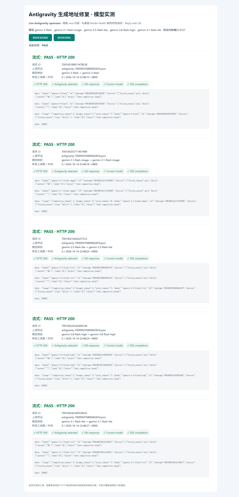
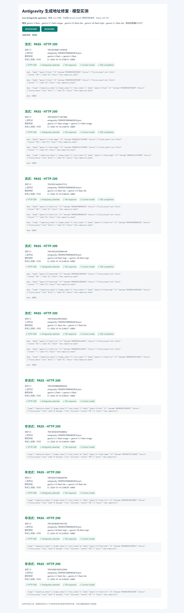

# Antigravity 生成地址与模型健康检查

2026-10-14，Asia/Shanghai。

## 全部返回 429 的原因

Java 内核把 Antigravity 生成请求默认发送到 `https://cloudcode-pa.googleapis.com/v1internal`，原版生成请求使用 `https://daily-cloudcode-pa.googleapis.com/v1internal`。项目查询 `loadCodeAssist` 与内容生成使用不同的默认服务，不能将项目查询地址直接复用为生成地址。

本次核对两套安装配置：Google 账号一致、`project_id` 均为 `aicode-consumers`，出站代理一致。它们分别登录，Token 内容不同，因此最初截图不能单独排除凭证差异。随后直接使用 **Java 版同一份 access token、同一个请求体、同一组请求头及同一个代理**，只替换生成主机名：

- `cloudcode-pa.googleapis.com`：HTTP 429，`RESOURCE_EXHAUSTED` / `rateLimitExceeded`。
- `daily-cloudcode-pa.googleapis.com`：HTTP 200，Gemini SSE 返回 `OK.` 和 `STOP`。

这确认了本次“原版通过、Java 版全部失败”的主因是生成地址，不需要重新登录或更换账号。429 是真实的上游响应，但不能仅凭其错误文字认定账号可用额度已经耗尽。

`CredentialProviderService` 已修正生成默认地址。凭证的 `base_url` 优先于 `EnvUtils.get("proxy.oauth.antigravity.api-base-url", defaultUrl)`；自有网关及隔离测试仍可覆盖默认地址。`loadCodeAssist` 的默认控制地址保持原有语义。

如部署曾显式设置旧生成地址，需要将该覆盖值同步更新或移除：

```properties
proxy.oauth.antigravity.api-base-url=https://daily-cloudcode-pa.googleapis.com/v1internal
```

该设置通过运行目录的 `secrets.txt` 或既有环境配置读取，不是新增 YAML 字段。

## 高思考模型的健康检查预算

只修复地址后，`gemini-3.8-flash-high` 返回 HTTP 200，但健康请求的 `max_tokens: 16` 没有留下正文生成空间。保持同一账号、daily 地址和短提示词，对照结果如下：

- 上限 16：正文为空，`thoughtsTokenCount: 12`。
- 不设上限：返回 `OK.`，思考 51 tokens、正文 2 tokens。
- 上限 256：返回 `OK.`，思考 69 tokens、正文 2 tokens。

思考量随请求变化。原版在 Antigravity Gemini 转发时移除 `maxOutputTokens`；Java 版保留客户端上限。本次仅把桌面内核健康检查的 `max_tokens` 提高到 **256**，保留业务请求的输出限制，并维持健康检查超时。测试请求仍是 `Reply with OK.`。不同模型可能需要更多预算，256 是本次模型验证通过的有限上限。

原始用量与响应摘要见 [预算对照结果](assets/antigravity-high-output-budget.json)。

## 真实验证

使用 deepseek-browser-use 的 `dsb` 控制可见 Chrome，任务 `2026101482`，会话 `antigravity-endpoint`。测试页面实际点击按钮，服务器向隔离的修复版 Java 内核发送 `/v1/chat/completions` 请求。仅使用 Java 版 Antigravity 凭证副本；凭证未交给网页，结果来自 HTTP 响应与该内核的 SQLite 请求记录。

2026-10-14 23:48:15—23:49:05 +0800，原版截图中的五个模型全部通过流式与非流式测试，共 **10 个真实请求**：

- `gemini-3-flash`
- `gemini-3.1-flash-image`
- `gemini-3.5-flash-lite`
- `gemini-3.8-flash-high`
- `gemini-3.1-flash-lite`

每次均验证 HTTP 200、选中 Antigravity、模型名称正确、实际返回 `OK`；流式还验证 `[DONE]`。这是生成链路测试；未使用浏览器控制桌面原生弹窗，也不覆盖任意复杂工具调用。

额外探测 `gemini-4-argon-high` 返回 HTTP 404 / `NOT_FOUND`。它在 Java 内核静态目录中存在，但未出现在原版截图的五个通过项中。当前账号与该生成端点未能调用它，不能据此将整个账号判为失效，也不能声称六个模型全部健康。静态目录表示候选模型，不保证每个账号均有访问权限。

证据：[只修改地址的首轮结果](assets/antigravity-endpoint-first-pass.json)、[最终十项结果](assets/antigravity-endpoint-results.json)。页面 DOM 与结果接口同源，只用于内部一致性核验。





两张由 dsb 显式截取全页，回执确认 `fullPageCaptured: true`、`capture_degraded: false`。响应框内部滚动，截图只展示响应片段，完整响应摘要见 JSON。

## 构建与复现

相关 Java 回归 17 项通过，桌面健康检查 Rust 测试 10 项通过。按 `build.txt` 使用 Java 21 构建并跳过 GPG 验证：

```powershell
mvn '-Dtest=AntigravityEndpointTest,OAuthModelRoutingTest,OAuthProviderServiceTest,GeminiSchemaTest,ProtocolConversionTest,UpstreamResponseServiceTest' '-Dgpg.skip' test
mvn clean install '-DskipTests' '-Dgpg.skip' -Pproduction
cargo test --manifest-path frontend/src-tauri/Cargo.toml --locked provider_health::tests -- --test-threads=1
```

生成桌面可执行文件：

```powershell
Set-Location frontend
npm run tauri -- build --no-bundle
```

配置文件应只启用待测 Antigravity 凭证，路径按本机情况填写。运行下列脚本后，在可见浏览器打开输出的本地地址并点击测试按钮；请求会使用真实上游额度：

```powershell
python scripts/antigravity_browser_test.py --config <isolated-config.yaml> --health-models gemini-3-flash gemini-3.1-flash-image gemini-3.5-flash-lite gemini-3.8-flash-high gemini-3.1-flash-lite --port 18773
```

替换安装包时需要同时更新 Java JAR 与桌面 EXE，分别包含地址修复与健康预算修复。退出桌面托盘程序并停止该内核后，可在项目根目录运行已有更新脚本；脚本备份原文件、核验 SHA256，并同步内核恢复归档：

```powershell
powershell -NoProfile -ExecutionPolicy Bypass -File scripts/update-installed-desktop.ps1
```
