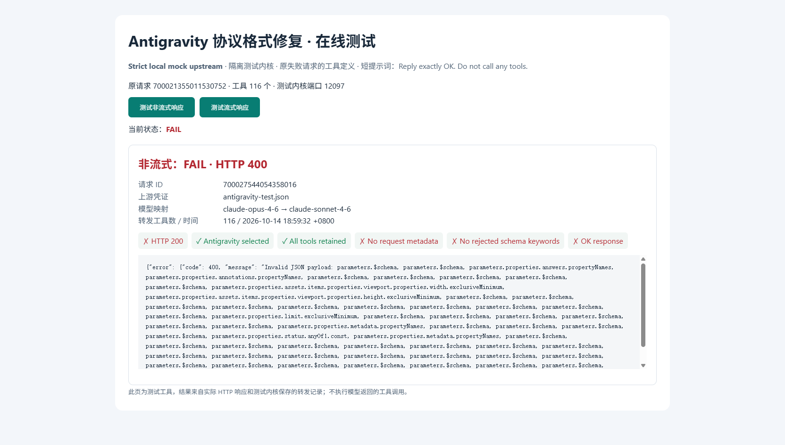
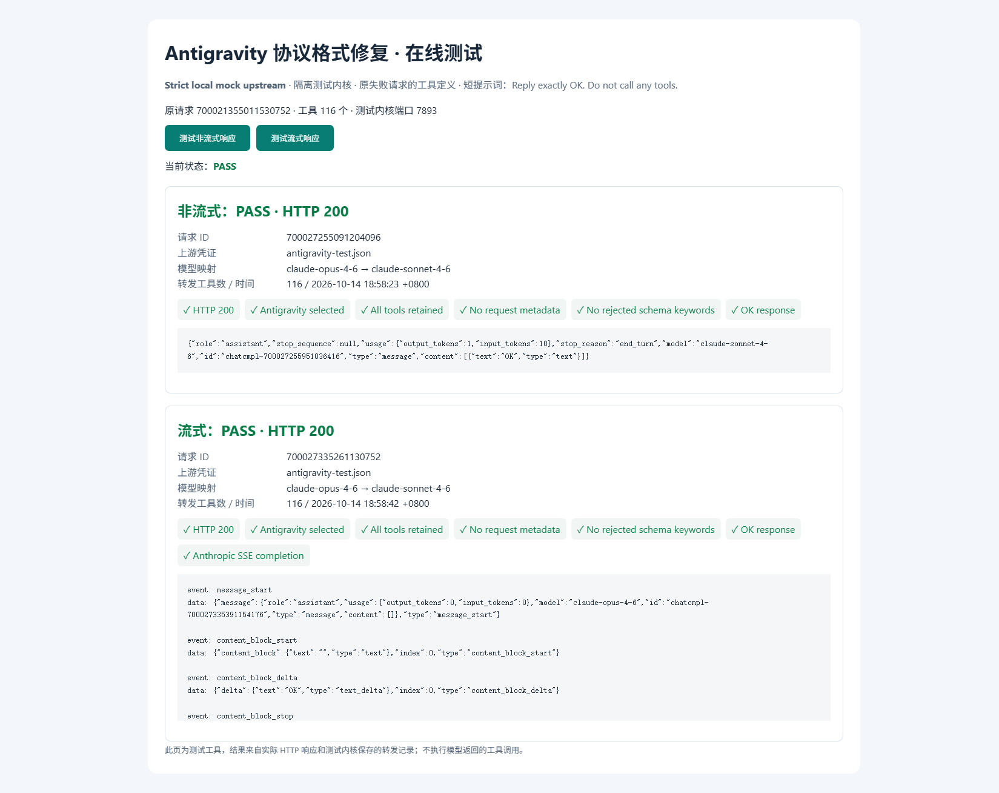
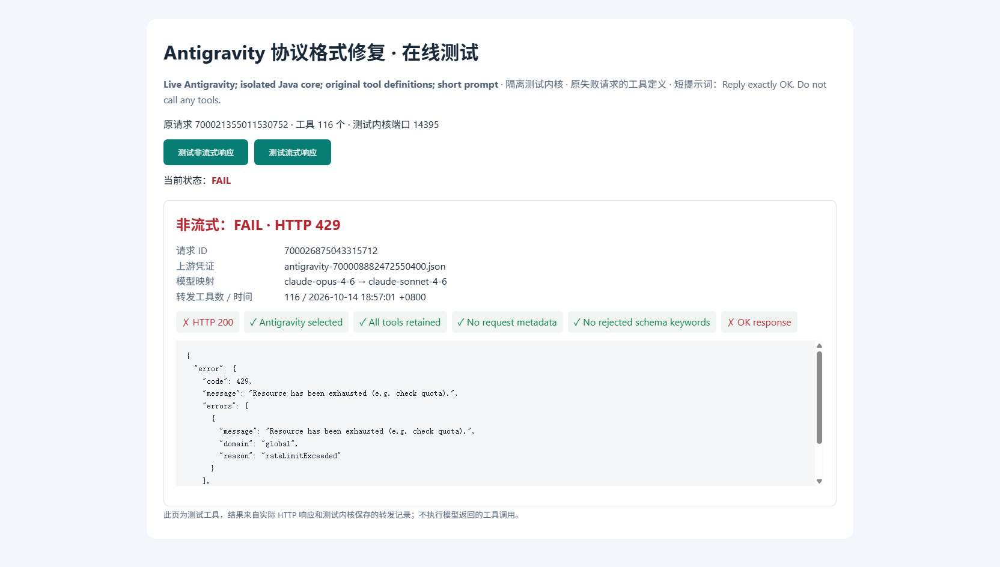

# Antigravity 协议格式修复与浏览器验证

2026-10-14（Asia/Shanghai）。关联原失败请求：`700021355011530752`。

## 问题与修改

Anthropic 请求转为 Gemini 格式后，代理仍将 `metadata` 放入 Antigravity 的 `request`，并原样转发工具 JSON Schema。原始上游错误明确拒绝 `metadata`、`$schema`、`propertyNames`、`exclusiveMinimum` 和 `const`。

修复仅作用于跨协议转换为 Gemini 的请求：

- 移除请求级 `metadata`，工具声明只输出名称、描述与参数。
- 在 Schema 节点递归移除 `$schema`，不误删同名业务属性或默认值内容。
- 字符串 `const` 转为单值 `enum`；整数严格上下界转为等价的包含式上下界，保留已有更强限制。
- `propertyNames: {type: string}` 为 JSON 对象键的固有要求，可移除；其它属性名约束、非整数严格边界及非字符串常量保留为描述提示，不能提供与原 JSON Schema 相同的机器校验保证。
- 原客户端请求保持不变，同协议请求保持原样。

此修复针对本次实际报错字段，不宣称支持任意 JSON Schema 特性。客户端的 `thinking: adaptive`、`output_config.effort` 映射不在本次验证范围内。

## 测试方法

通过 deepseek-browser-use 仓库中的 `dsb` CLI 控制可见 Chrome，任务 `2026101481`、会话 `antigravity-schema`。浏览器实际点击测试按钮，页面将请求发给隔离 Java 内核；结果从 HTTP 响应及该内核保存的转发记录读取，不是预置的成功页面。

全部用例保留原失败请求的 **116 个工具定义**，将对话替换为 `Reply exactly OK. Do not call any tools.`，输出上限 64 tokens；不执行返回的工具调用。现有 Claude Desktop 的 `claude-opus-4-6 → claude-sonnet-4-6` 映射用于真实上游测试，本地配置显式复现同一映射。

本地模拟上游校验本次报错的 Schema 关键字、请求 metadata、工具数和模型，然后返回 Antigravity 包装的 Gemini JSON/SSE。它没有实现完整 Google Schema 验证器，不能替代真实上游成功验证。

## 结果

| 用例 | 实际结果 | 结论 / 请求 ID |
|---|---|---|
| 单元与协议回归 | 6 项通过，0 失败 | `GeminiSchemaTest`、`ProtocolConversionTest` |
| 原失败请求本地转换 | 116 个工具保留、被拒字段清除、原始对象不变 | PASS |
| 旧包 + 本地严格校验上游 | HTTP 400；metadata 与 Schema 关键字仍存在 | 复现缺陷：`700027544054358016` |
| 修复包 + 本地上游，非流式 | HTTP 200，Anthropic message 返回 `OK` | PASS：`700027255091204096` |
| 修复包 + 本地上游，流式 | HTTP 200，返回 `OK` 和 `message_stop` | PASS：`700027335261130752` |
| 修复包 + 真实 Antigravity，非流式 | HTTP 429，`RESOURCE_EXHAUSTED` / `rateLimitExceeded` | 生成验证未通过：`700026875043315712` |
| 修复包 + 真实 Antigravity，流式 | 未发送，避免 429 后继续重试 | NOT_RUN |

真实上游测试时间为 18:57:01 +0800。转发记录确认走 `antigravity-700008882472550400.json`，116 个工具完整且已无本次被拒字段；但 **429 不证明上游所有格式检查均已通过，也不能单凭错误文字认定账号配额耗尽**。后续短请求对照发现生成默认地址应使用 daily 服务，同一个 Token 和请求在旧地址返回 429、daily 地址返回 200。详见 [生成地址与模型健康检查](antigravity-generation-endpoint.md)。本节 116 个工具的真实请求尚需单独复测。

原始结果摘要见 [JSON 证据](assets/antigravity-schema-results.json)。DOM 与接口结果属于同一测试数据源，用于内部一致性检查，不作为两个独立来源。

## 截图

三张均由 dsb 显式截图，回执 `fullPageCaptured: true`、`capture_degraded: false`。截图展示完整页面布局，响应框内部有滚动，仅显示响应片段；完整检查项与响应摘要以 JSON 证据为准。

### 旧包复现 400



### 修复包：本地非流式与流式通过



### 真实上游：当时返回 429



## 复现

```powershell
mvn -q '-Dtest=GeminiSchemaTest,ProtocolConversionTest' test
mvn -q package -DskipTests -Pproduction

# 指定包含原失败请求的数据库和运行配置；路径由本机环境决定。
python scripts/antigravity_browser_test.py --config <config.yaml> --database <proxy.db> --mock --port 18771
```

在可见浏览器打开脚本输出的地址，依次点击非流式、流式测试按钮。去掉 `--mock` 才会使用真实账号和额度。用 `--jar <old.jar>` 可对照旧包。测试凭证不下发到页面，原始对话不写入文档；隔离内核的日志和请求记录保存在 `target/antigravity-browser-*`。
