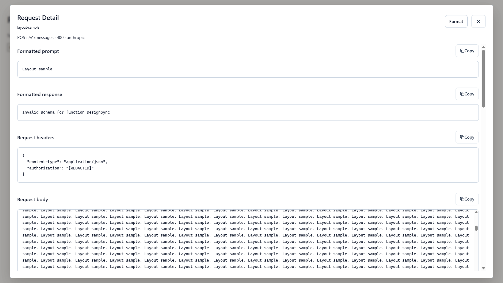

# 后端适配与验证

桌面直接保留原项目页面，Java 内核提供页面调用的管理接口。管理接口使用 `RespBodyVo`，Tauri 原生层统一解包；模型接口保留对应协议的响应结构。

## OAuth 和插件

授权码流程支持 PKCE、状态校验、回调路径与端口校验、取消、有效期和防重放。设备码流程支持待授权、轮询和成功保存。内置 Codex、Claude、Antigravity、Kimi、Kimi AI、xAI、Meta、Devin；Vertex 服务账号通过 JWT 获取令牌。Devin 请求使用 Connect-RPC，遇到令牌过期可刷新后重建请求。

插件商店安装检查产物大小、摘要及压缩包路径。原生 ABI 支持注册、重新配置、OAuth、凭证解析、配额、模型发现、模型执行、流式输出、管理页面、资源、调度、鉴权、请求与响应处理、命令行扩展和用量通知。插件命令支持原参数名，也支持 `--plugin.<插件标识>.<参数名>=值`，命令执行结束使用插件返回的退出码。

请求处理顺序为凭据选择前钩子、路由与凭据选择、原生协议转换、请求规范化、凭据选择后钩子、执行。响应规范化分别位于转换前后；缺少原生转换时使用插件转换器。流式处理按 SSE 事件边界调用钩子，保留 UTF-8 字节和事件边界。

插件集成测试实际编译并加载原生 DLL，覆盖凭证解析、登录、配额、宿主回调、HTTP 执行、嵌套模型、普通及流式请求、命令行、重配置和卸载。测试 DLL 用 Rust 构建；第三方 Go 插件仍需使用真实产物验证其运行时行为。

## 模型接口

| 接口 | 当前行为 |
| --- | --- |
| `/v1/chat/completions`、`/v1/messages`、`/v1/responses`、Gemini 生成接口 | 四协议普通请求与 SSE 转换；同协议保留扩展字段 |
| `/v1/completions`、`/v1/messages/count_tokens`、`/v1/responses/compact` | 对应协议转发 |
| `/v1/models`、`/v1/models/*` | 可用模型与模型详情 |
| `/v1beta/models`、`/v1beta/models/*` GET | Gemini 模型列表与详情 |
| `/v1/images/generations`、`/v1/images/edits` | 原生提供方调用；编辑支持 JSON 与 multipart 文件 |
| `/v1/videos`、`/v1/videos/generations`、`/v1/videos/edits`、`/v1/videos/extensions` | 原生视频任务提交与任务绑定保存 |
| `/v1/videos/{id}`、`/openai/v1/videos/{id}` | 使用任务创建时的凭据查询 |
| `/openai/v1/videos`、`/openai/v1/videos/{id}/content` | OpenAI 原生视频创建及二进制内容 |
| `/v1/audio/speech`、`/v1/tts` | 原生音频响应；二进制内容原样返回 |
| `/v1beta/interactions` | 配置的 Gemini 原生接口，支持 JSON/SSE |
| `/v1/alpha/search` | 配置的 Responses 提供方原生搜索入口 |
| `/v1/responses` WebSocket | 握手鉴权、别名、双向消息、连续对话及详情记录 |
| `/v1/realtime` WebSocket | 使用查询参数中的 model 建立上游连接，转发主动会话事件及双向消息 |

多媒体测试使用支持对应原生接口的本地提供方。它不代表 xAI OAuth 私有媒体工作流、OpenAI 与 xAI 视频协议互转、Gemini agent/深度研究模式已经实现。视频任务按客户端密钥隔离，并在重启后保留凭据绑定；删除原凭据后无法继续查询该任务。

## Codex CLI 语音

已增加 `/v1/live` 会话创建及三种后续 WebSocket 连接形式，支持账号绑定、访问密钥隔离和工具前缀。路径、配置与测试范围见 [Codex CLI 语音会话](codex-live.md)。

## Responses 的 HTTP、SSE 与 WebSocket

Responses API 支持 HTTP 调用，也有 WebSocket 模式。SSE 是 HTTP 流式响应，不需要 WebSocket 握手；WebSocket 模式允许客户端在同一连接上发送多轮 `response.create` 事件。它与 `/v1/realtime` 的实时会话接口分别注册。

| 调用方式 | 本地地址 | 返回形式 |
| --- | --- | --- |
| HTTP POST，`stream` 为 `false` 或省略 | `http://127.0.0.1:8318/v1/responses` | JSON |
| HTTP POST，`stream` 为 `true` | `http://127.0.0.1:8318/v1/responses` | `text/event-stream`（SSE） |
| WebSocket 握手，随后发送 `response.create` | `ws://127.0.0.1:8318/v1/responses` | WebSocket 文本帧中的 JSON 事件 |

因此，`server.getWebSocketRouter().add("/v1/responses", new ResponsesWebSocketHandler())` 用于兼容选择 WebSocket 模式的客户端，普通 HTTP 请求仍由 `ResponsesHandler` 处理。参考 Go 后端也为同一路径分别注册 GET WebSocket 握手与 POST 请求。

下面展示本应用两种路由的注册方式。tio-boot 默认 `server.protocol=auto`，根据握手中的 `Upgrade: websocket` 区分传输方式，两个处理器共用端口和路径：

```java
import nexus.io.llm.proxy.handler.ResponsesHandler;
import nexus.io.llm.proxy.handler.ResponsesWebSocketHandler;
import nexus.io.tio.boot.server.TioBootServer;
import nexus.io.tio.http.server.router.HttpRequestRouter;

public class ResponsesRoutes {
  public void config() {
    TioBootServer server = TioBootServer.me();
    HttpRequestRouter router = server.getRequestRouter();
    router.post("/v1/responses", new ResponsesHandler()::handle);
    server.getWebSocketRouter().add("/v1/responses", new ResponsesWebSocketHandler());
  }
}
```

WebSocket 模式要求所选上游支持对应的 WebSocket 接口，当前应用直接桥接上下游连接；只有 HTTP/SSE 能力的上游应使用 POST 入口。管理接口采用 `RespBodyVo`，模型接口则保持 OpenAI JSON、SSE 或 WebSocket 事件结构，供标准客户端解析。

协议参考：[OpenAI Responses WebSocket mode](https://developers.openai.com/api/docs/guides/websocket-mode)、[Streaming API responses](https://developers.openai.com/api/docs/guides/streaming-responses)。

## 路由和请求详情

Request Detail 使用接近窗口全尺寸的布局，宽度最多 1600 像素，顶部格式化和关闭按钮固定，详情内容独立滚动；较长的请求体和响应体还可在各自区域中滚动。在 784×541 视口下，弹窗为 752×509，避免被公共表单弹窗的固定宽高限制。

下面使用约 252 KB 合成请求体，在可见 Chrome 中通过 DeepSeek Browser Use 验证布局、格式化按钮、正文滚动和窄窗口适配。截图只展示布局测试数据：



### 工具参数中的 Long 数值

记录 `699964803651096576` 的上游返回 `Invalid schema for function 'DesignSync'`：原始工具定义中的 `maximum: 9007199254740991` 在转发序列化后变成字符串，JSON Schema 要求该字段为 number，因此返回 400。

协议报文改用 `JsonUtils.toJsonWithLongAsNumber`，由当前 JSON 工厂处理，同时保留 Long 的数值类型。覆盖 HTTP 请求、协议转换、工具参数、SSE、WebSocket、原生端点及插件模型转发；管理响应仍使用原有序列化策略。该方法不会把原本的数字字符串强制转换为数字。

验证包括：32 种 HTTP 协议组合检查 `maximum`、`minimum`、`default` 的数值类型以及字符串枚举；WebSocket 集成测试；使用原请求全部 116 个工具定义、简短测试提示和流式调用访问已配置的 DeepSeek。线上验证记录 `699971386395443200` 返回 HTTP 200 和 `OK`，未执行模型工具，也没有重放原对话。

模型前缀、API Key 分组别名、OAuth 别名、会话绑定和 Payload 规则在服务端生效。可重试错误在同一凭据重试耗尽后切换其他可用凭据，`max-retry-credentials` 限制一次请求尝试的凭据数量；零表示不限制。流式响应已经向客户端输出后不切换凭据。

Usage 详情包含客户端和上游的请求、响应头与正文；认证头脱敏，正文按捕获上限截断。插件改变请求时保存实际执行的内容。二进制内容使用 Base64 展示；Devin 展示解码后的消息。格式化功能从支持的协议中提取提示词、工具调用和响应，便于复制。

## 验证边界与待适配范围

- OAuth 的八种提供方流程已通过模拟服务测试，真实账户、配额和提供方特殊请求头仍需在线验证。
- 已验证四协议的 32 种 HTTP 组合，以及上传、视频任务、二进制返回、Responses 和 Realtime WebSocket。
- Realtime WebRTC、SIP 控制、翻译会话以及 Codex 专用 continuation/replay 行为尚未完整移植。
- 高级跨协议内容（签名思考、音视频、文件、缓存控制、多候选结果等）和复杂 GJSON Payload 表达式尚未全面覆盖；同协议字段可保留。
- 插件嵌套调用尚未完整复用入口请求的 Usage 记录与全部拦截阶段；Go 原生插件并发卸载、更多商店压缩格式和宿主传输选项仍需补齐验证。
- 当前重试提供失败凭据切换，参考项目完整的按凭据轮次重试、会话重绑定策略、Home 与发现服务等仍需进一步适配。

这些项目是应用适配范围，不涉及修改底层框架的使用约定。
