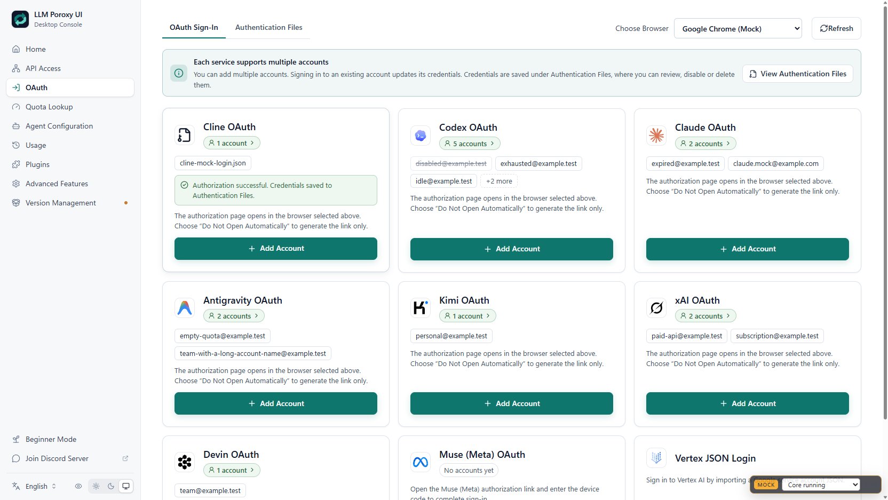

# Cline 原生账号接入

Cline 已直接接入 Java OAuth、凭据管理与 OpenAI Chat 转发，无需 Node 辅助进程。桌面 OAuth 页选择 Cline，打开授权链接并按提示完成设备码授权；凭据保存在现有账号目录，支持多账号管理和刷新。

## 认证和推理

流程为 WorkOS 设备授权 → 轮询 token → Cline register → 保存产品凭据。推理保留 `Bearer workos:` 前缀，刷新调用 Cline 自己的 JSON 接口。状态接口不会返回 access token 或 refresh token。

模型目录动态合并 `/models` 和 `/ai/cline/recommended-models`，缓存 60 秒，不内置固定的免费模型名单。上游模型下架或账号权限变化后，以重新获取的目录为准。

上游始终使用 SSE。客户端 `stream=true` 时透传，普通请求聚合为 Chat Completion JSON，保留工具调用、思考字段和 usage。聚合会拒绝错误事件、截断和超限响应。原生支持 `/v1/chat/completions`；其他协议入口经过项目已有转换层，未宣称完整保留跨协议思考字段。不提供 Cline 原生图像、音频、视频或 Responses 端点。

## 可选配置

默认使用公开产品端点，一般不需要额外配置。测试或端点调整可使用：

```properties
proxy.oauth.cline.client-id=client_01K3A541FN8TA3EPPHTD2325AR
proxy.oauth.cline.device-url=https://api.workos.com/user_management/authorize/device
proxy.oauth.cline.token-url=https://api.workos.com/user_management/authenticate
proxy.oauth.cline.api-base-url=https://api.cline.bot/api/v1
proxy.oauth.cline.max-response-bytes=33554432
```

还支持 `register-url`、`refresh-url`、`models-url`、`recommended-models-url` 的单独覆盖。网络代理沿用管理 HTTP 客户端配置。

## 验证记录

2026-10-16：后端 69 项单元测试通过，新增 Cline 测试覆盖设备轮询、拒绝、取消、退避、注册、刷新、模型合并、SSE 聚合、工具分片、错误和大小限制。前端类型检查、27 项相关前端测试、1 项 Rust 设备流程测试通过。

`scripts/cline_integration_test.py` 启动隔离 Java 和本地 HTTP 替身，使用随机空闲端口，验证管理鉴权、授权落盘、刷新、JSON 和 SSE 推理。未使用 8318，也未读取现有账号。构建遵循 `build.txt` 并跳过 GPG。

使用 deepseek-browser-use 在可见 Chrome、前端 18319 端口验证 Cline 卡片从无账号到模拟登录成功，并显示新增账号。下图为完整页面截图，属于模拟授权 UI 证据，不能作为真实上游登录证据。真实 Cline 授权和上游推理尚未执行。



## 来源

协议参考 OFM 的 `vendor/channel-pack/src/cline*.ts`。账号包源自 [dsh-codearts-auth](https://gitee.com/iJetLi/deepseek-harness-codearts)，版权为 Copyright (c) 2026 Jet；保留 [MIT 许可全文](licenses/channel-pack-MIT.txt)。渠道总体分析见 [OFM 账号渠道分析](ofm-oauth-channel-analysis.md)。
