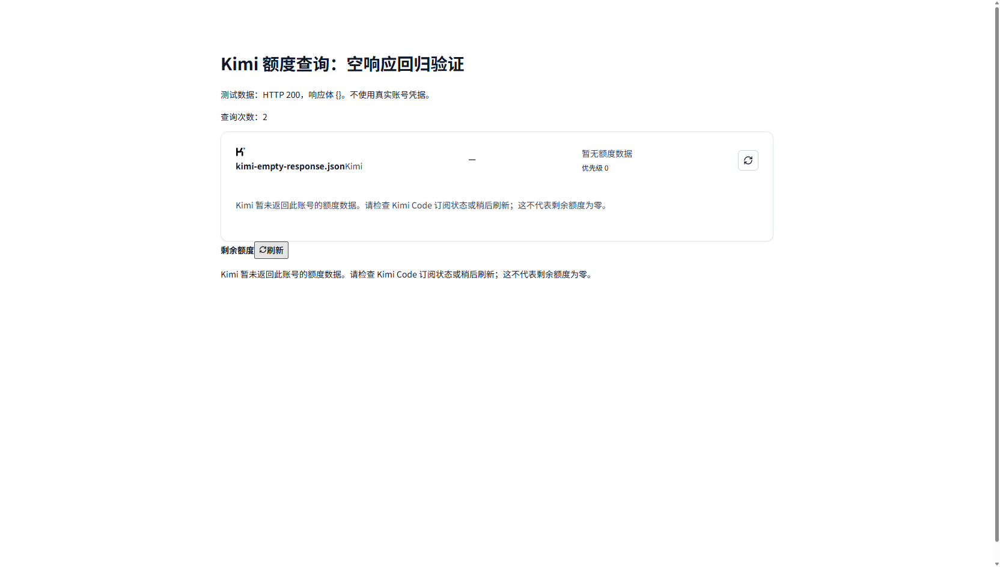

# Kimi 登录后的额度查询

Kimi 登录成功和额度查询返回数据是两个独立结果。额度接口 `GET https://api.kimi.com/coding/v1/usages` 有时返回 HTTP 200，但响应体是空对象：

```json
{}
```

2026-10-14 排查时，当前账号通过代理管理接口查询与直接调用官方接口均得到这一结果。因此该情况表示此次没有获得额度数据，不能据此判断剩余额度、是否订阅或登录是否失效。

额度查询页和凭据详情页现在将这一响应显示为“暂无额度数据”，保留刷新入口，并提示检查 Kimi Code 订阅状态或稍后重试。不会显示虚构的 0%、100% 或进度条。

其他结果保持明确区分：

| 响应 | 页面行为 |
| --- | --- |
| HTTP 200，空对象 `{}` | 暂无额度数据，允许刷新 |
| HTTP 200，合法额度字段且剩余为 0 | 显示真实的 0% |
| HTTP 200，非空但无法识别的结构 | 显示格式错误 |
| HTTP 401 或其他失败状态 | 显示请求失败 |

验证包括 58 项额度解析、请求及卡片测试，以及 TypeScript 检查和前端 production 构建，均通过。此次修改位于应用前端，无需修改 Java 内核或框架。

浏览器验证使用 deepseek-browser-use 的可见 Chrome。测试页使用 HTTP 200 / `{}` 的模拟响应，依次点击额度卡片和凭据面板的刷新按钮，查询次数从 0 增加到 1、2，两处均显示中性提示且刷新按钮保持可用。下图为测试页视口截图，不含真实账号或凭据。



启动前端后，打开 `tests/fixtures/kimi-empty-quota.html` 可以重复上述界面验证。

```bash
bun test tests/quotaRequests.test.ts tests/quotaRendering.test.tsx tests/quotaService.test.ts
npm run check
npm run build
```
