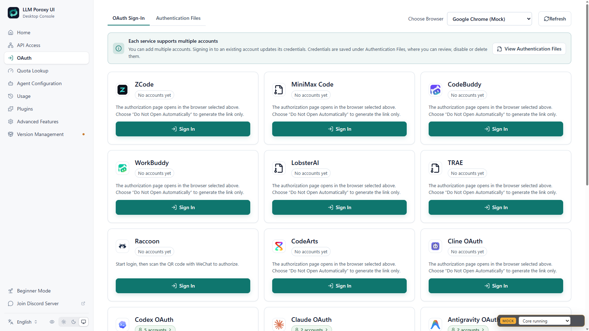
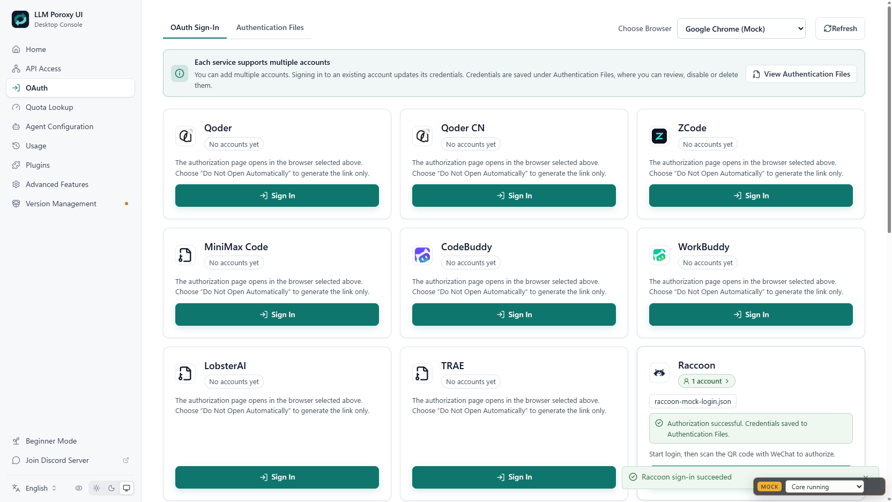
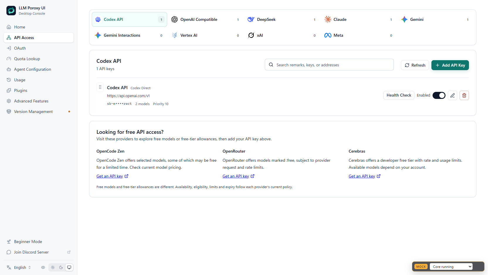

# 原生账号渠道接入

账号认证、凭据存储与刷新、模型发现、上游推理统一由 Java 管理，桌面端复用现有账号列表。管理 API 继续使用管理密钥鉴权，一个接口对应一个 Handler，业务服务通过 Aop 获取，配置通过 EnvUtils 读取。

## 已实现的渠道

- Cline：WorkOS 设备授权后注册产品 token，OpenAI Chat，保留 `workos:` 前缀。
- MiniMax Code：设备码与 PKCE，兼容 HTTP 200 pending 状态，Anthropic Messages。
- CodeBuddy / WorkBuddy 国际版 / WorkBuddy 国内版：三个独立渠道，腾讯浏览器授权、token 与账号分步轮询，OpenAI Chat，按产品设置身份头。国内版使用独立账户接口，见 [WorkBuddy 国内版](workbuddy-cn.md)。
- LobsterAI：本地回调授权码交换，保存安装标识，OpenAI Chat。
- TRAE：本地 token 回调，通过 login trace 关联会话；SOLO 请求与 SSE 事件转换，按远端模型对应的 channel 转发。
- CodeArts：PKCE 与 DPoP，临时 AK/SK/security token；在请求体确定后进行 SDK-HMAC 签名；支持 DeepSeek DSML 工具事件转换。
- Raccoon：微信扫码登录与令牌刷新，OpenAI Chat；页面在本地生成二维码，不把登录链接发送到第三方二维码服务。
- Loomy：短信验证码登录、HMAC-SHA1 和 Content-MD5 签名。发送短信需要用户点击按钮，验证码由用户填写。
- ZCode：CLI 授权初始化与轮询，Anthropic Messages；支持已有 coding-plan key 的显式切换，详见 [ZCode 通道说明](zcode-channels.md)。
- Qoder / Qoder CN：设备授权与 PKCE、凭据刷新，Java 直接运行 WASM 生成加密推理请求；两个产品分别保留授权和服务域名。配置方式见 [WASM 接入说明](qoder-wasm-java-analysis.md)。

源项目名为 Gemini 的账号渠道与当前 Antigravity 使用相同 OAuth client ID、ANTIGRAVITY 身份和 daily Cloud Code 推理服务，不重复新增。

两者的推理主地址均为 `https://daily-cloudcode-pa.googleapis.com`，流式路径为 `/v1internal:streamGenerateContent?alt=sse`，非流式路径为 `/v1internal:generateContent`。辅助接口路由不完全相同：源项目支持 daily/sandbox 切换，项目探测优先 `daily-cloudcode-pa.sandbox.googleapis.com`；当前 Antigravity 的 `loadCodeAssist` 默认使用 `cloudcode-pa.googleapis.com`。这是同一产品渠道的路由策略差异，不能视为独立额度。

## 登录和使用

在 OAuth 页选择提供商，设备授权显示链接与用户码，回调登录在 Java 所在机器监听 loopback。远程部署时，需要浏览器能访问该机器的回调地址。Raccoon 使用微信扫码，Loomy 使用独立短信卡片。

LobsterAI 默认回调 `http://127.0.0.1:18321/auth/callback`，TRAE 默认 `http://localhost:18080/authorize`；可用 `proxy.oauth.<provider>.redirect-uri` 覆盖，需保持上游支持的路径。CodeArts 选择独立动态 loopback 端口。设备码和二维码不需要额外回调端口。

凭据保存后，`/v1/models` 返回各渠道模型目录。Qoder 使用源项目模型快照，标记 `catalog_source=snapshot`，不代表账号当前有权调用全部模型；其他渠道按各自服务发现模型。使用实际返回的模型 ID 调用 `/v1/chat/completions`；MiniMax 和 ZCode 原生支持 `/v1/messages`。其他现有协议入口通过应用转换层连接，跨协议思考签名等扩展字段没有完整兼容保证。

非流式请求会聚合必须使用 SSE 的上游响应。聚合保留文本、工具调用、reasoning/thinking 和 usage，限制缓存大小并拒绝截断、错误事件。流式请求增量发送，不等待全部内容。

## 模型目录与凭据刷新

原生账号在发现模型前先刷新到期凭据，避免因旧令牌查询失败而无法进入路由。一个账号刷新失败不会影响其他账号。模型目录按产品、服务地址和凭据摘要隔离，默认缓存 60 秒；短暂网络故障时最多保留 300 秒内的旧目录。成功返回的空目录会立即覆盖旧值，切换账号、令牌或 ZCode 通道也会隔离缓存。

可在应用配置中调整缓存时间，所有配置均通过 `EnvUtils` 读取：

```properties
proxy.oauth.catalog-ttl-seconds=60
proxy.oauth.catalog-stale-seconds=300
```

回调端口可配置，例如：

```properties
proxy.oauth.lobsterai.redirect-uri=http://127.0.0.1:18321/auth/callback
proxy.oauth.trae.redirect-uri=http://localhost:18080/authorize
```

这些是登录回调端口，不是代理服务监听端口；修改前应确认上游接受相应回调地址。

## 真实能力边界

- WorkBuddy 国内版 `workbuddycn` 使用 `https://www.workbuddy.cn`、`platform=workbuddy`；国际版 `workbuddy` 使用 `https://www.workbuddy.ai`、`platform=workbuddy-ai`。`buddy` 是 CodeBuddy，不能视为 WorkBuddy 国内版，也不能将两区账号或模型池视为通用。

- 登录、模型发现和实际推理是三个不同状态。本文的本地替身测试不能证明真实账号当前额度或模型可用性。
- Loomy 无刷新接口，session 到期需重新登录；当前提供短信登录，不提供其微信绑定流程。
- Raccoon 当前界面提供扫码；短信服务代码要求人工完成验证码，未提供滑块 UI。
- TRAE 当前提供本地 token 回调；新版 authCodeInfo/PKCE 回调、Max 模式额外策略未实现。不会轮换设备标识尝试获得新额度。
- CodeArts 旧 ticket 凭据可能没有刷新材料，到期需要重新授权。
- ZCode 平台 JWT 到期需要重新授权；已有 coding-plan API key 独立于平台 JWT。验证码挑战和账号限制明确报错，不自动重试。
- API Access 下方提供 OpenCode Zen、OpenRouter、Cerebras 官网申请入口。免费模型与免费额度不同，以提供商当前政策为准。

## 测试与来源

2026-10-16 非 WASM 批次验证：Java 单元测试 119 项全部通过；两条生产构建命令通过；HTTP 集成验证覆盖 MiniMax、Buddy、WorkBuddy、LobsterAI、TRAE、Loomy、CodeArts、Raccoon、ZCode 共 9 个渠道。测试包括管理鉴权、登录、模型发现、JSON/SSE 推理，并验证 CodeArts 实际发送字节的 HMAC 签名和 ZCode 验证码挑战不触发重试。前端 TypeScript 检查与生产构建通过。以上均为本地替身验证，未使用真实上游账号。

同日 Qoder 接入后的最终验证：130 项 Java 测试全部通过，两条构建命令再次通过；上述 9 个渠道、Qoder 双区以及 Cline 共 12 个渠道的 HTTP 替身测试通过。Qoder 测试直接执行已有 WASM，验证真实生成的 COSY 签名与加密正文送达本地上游，并验证 JSON/SSE 转换。前端 45 项相关测试、1 项 Rust OAuth 测试、类型检查和生产构建通过。

测试使用独立工作目录、随机空闲端口及本地 HTTP 上游替身；不占用 8318，不读取现有账号，不发送真实短信或消耗额度。可运行：

```powershell
mvn test '-Dgpg.skip'
mvn clean install -DskipTests '-Dgpg.skip'
mvn package -DskipTests -Pproduction '-Dgpg.skip'
python scripts/cline_integration_test.py
python scripts/native_channels_integration_test.py
# Set QODER_WASM_PATH to an existing verified WASM file first.
python scripts/qoder_integration_test.py
```

界面验证使用 deepseek-browser-use 可见 Chrome，前端测试端口 18319，模拟授权用于验证卡片与账号展示。





协议参考 OFM 的 `vendor/channel-pack/src`。保留 [账号包 MIT](licenses/channel-pack-MIT.txt) 与 [OFM MIT](licenses/OFM-MIT.txt)。`frontend/src/assets/icons/ofm-*.png` 从 OFM `client.js` 内嵌图片提取，不是新绘制的品牌图标。


