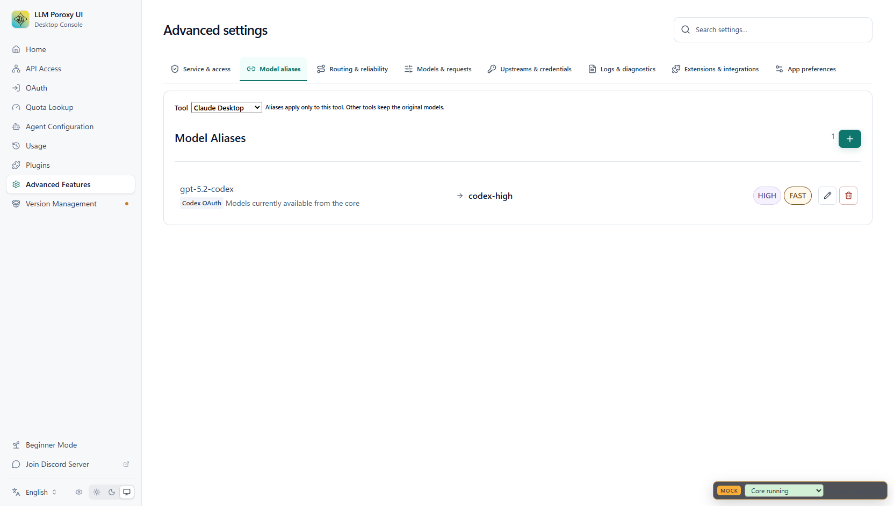
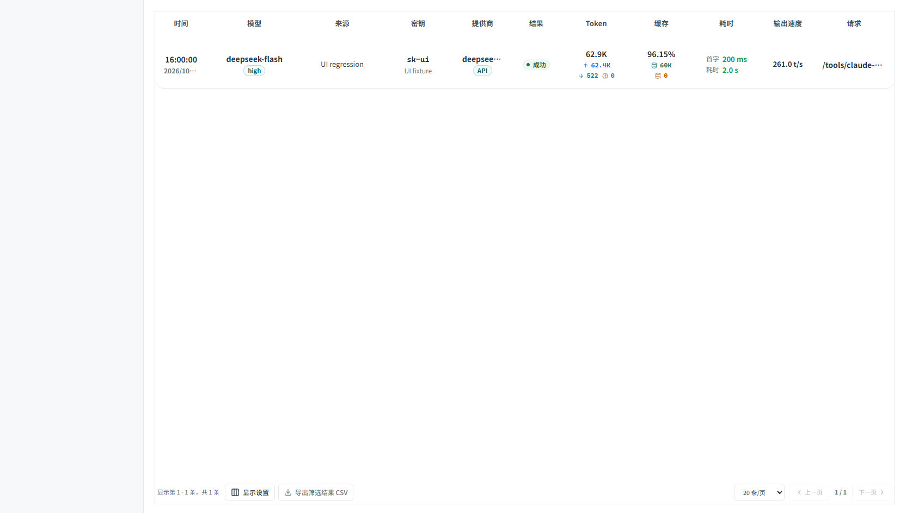

# 工具独立模型别名与请求统计

模型别名按客户端工具保存。Claude Desktop、Claude Code、Codex、OpenCode、OpenClaw、Hermes、DeepSeek Harness、ZCode、WorkBuddy、Antigravity CLI、Copilot CLI、VS Code Copilot、Kimi Code、Grok Build、OMP、Pi 分别使用自己的配置。

## 配置与接入

1. 打开“高级功能 → 模型别名”，先选择工具，再创建或修改别名。
2. 在“工具配置”中更新对应客户端的连接配置，并重新启动客户端，使其读取新地址。
3. 模型选择器保留原始模型，同时显示当前工具的别名。其他工具的别名不会进入该列表。

例如，同一个 `shared-alias` 可以在 Claude Desktop 中指向 `deepseek-flash`，在 Codex 中指向 `deepseek-v4-pro`。删除其中一个工具的别名不会删除另一个工具的配置。

生成的连接地址包含工具标识，例如：

| 工具 | 连接地址示例 |
| --- | --- |
| Claude Desktop | `http://127.0.0.1:8318/tools/claude-desktop` |
| Claude Code | `http://127.0.0.1:8318/tools/claude-code` |
| Codex | `http://127.0.0.1:8318/tools/codex/v1` |
| OpenCode | `http://127.0.0.1:8318/tools/opencode/v1` |

端口以实际监听配置为准。模板生成、配置更新和 Codex 登录模式切换均保留工具范围。已有客户端需要更新连接配置；识别旧地址不代表已经启用了工具专属地址。

手动接入时可以使用工具路径，也可以在公共路径上设置 `x-llm-proxy-tool` 请求头。路径的优先级高于请求头。所有工具路径仍由同一个 token 拦截器进行认证，工具标识用于配置隔离，不用于授予权限。

```bash
curl http://127.0.0.1:8318/tools/codex/v1/models \
  -H "Authorization: Bearer $PROXY_API_KEY"

curl http://127.0.0.1:8318/tools/codex/v1/chat/completions \
  -H "Authorization: Bearer $PROXY_API_KEY" \
  -H "Content-Type: application/json" \
  -d '{"model":"shared-alias","messages":[{"role":"user","content":"hello"}],"stream":true}'
```

无工具标识的公共模型列表只展示原始模型。系统也支持部分客户端 User-Agent 的兼容识别，建议使用明确的工具路径，避免依赖客户端版本的 User-Agent 格式。

## 存储与旧配置

专属设置保存在 `tool-model-aliases.<tool>`，其中包含 provider 模型映射、OAuth 模型映射及别名相关的请求参数规则。保存操作只更新当前工具，检测过期编辑，并在后续本地配置写入失败时恢复当前工具的原始设置。

provider 映射使用稳定身份摘要关联凭据，避免 provider 列表重排后关联到另一项；工具别名配置不复制 API key。更换 provider 地址、前缀、凭据或兼容 provider 名称后，应重新选择来源并保存别名。

为保留已有桌面映射，尚未建立专属配置的 Claude Desktop 会读取旧别名；首次保存后改用自己的设置。其他工具不会继承旧全局别名。需要在其他工具使用旧别名时，请在该工具下重新创建。

## Request Details

请求详情默认显示提供商列，模型主列显示实际发送到上游的模型，不再把请求别名作为主标签。用量汇总和模型筛选也使用实际模型。

| 字段 | 含义 |
| --- | --- |
| `provider` | 实际选中的上游 provider 配置名称 |
| `model` | 路由及请求转换后发送给上游的模型 |
| `alias` | 客户端原始请求的模型名称，保留在提示和导出中用于排查 |
| `response_model` | 上游响应声明的模型，在协议转换前采集 |

当响应模型与路由模型不同，页面保留响应模型提示。响应字段只能说明上游声明的身份，不能验证上游内部的实际部署。

DeepSeek 的 `usage.prompt_cache_hit_tokens` 现在会计入缓存读取统计，同时兼容 OpenAI 的 `prompt_tokens_details.cached_tokens`、Responses 的 `input_tokens_details.cached_tokens` 等格式。OpenAI 兼容流式聊天请求会启用 `stream_options.include_usage`，并在转成其他协议前采集用量，避免转换丢失缓存字段。

DeepSeek 请求也可能没有命中缓存，因此不会根据提供商名称推算或强制生成缓存数值。统计以本次上游实际返回的 usage 为准。历史记录若没有采集到缓存或真实模型信息，无法从旧的零值或别名可靠补回。

## 验证与截图

Java 单元测试覆盖流式分片、DeepSeek 缓存字段、嵌套 Responses 用量、真实零命中、工具独立路由及 provider 身份隔离，共 20 项通过。

使用本地 DeepSeek 兼容测试服务验证打包后的代理：

```bash
python scripts/test-tool-aliases.py --java java
```

该脚本验证 token 校验、公共与工具模型列表、同名别名独立路由、跨工具拒绝、JSON/SSE 协议转换、真实 provider/model 记录，以及 60,000 个缓存命中 token。测试不会请求真实 DeepSeek 服务。

前端 `npm run check`、`npm run build` 通过。Rust 回归情况见 [测试记录](tool-model-aliases-tests.md)。

浏览器验证使用有界面的 deepseek-browser-use。以下截图均为视口截图，页面使用测试数据：

- Codex 新建 `codex-isolated-test`，回读列表确认保存成功。
- 切换 Claude Desktop，回读列表确认只出现该工具原有的 `codex-high`。
- Request Details 测试页断言主模型为 `deepseek-flash`、提供商为 `deepseek-1`、缓存为 `60K`、命中率为 `96.15%`。输入 token 为 62,400；原始请求别名 `claude-sonnet-4-5` 仅保留在诊断提示中。






可打开 `tests/fixtures/usage-response-model.html?scenario=deepseek&locale=zh-CN`，然后通过 dsb 执行 `frontend/tests/usage-deepseek-browser.js` 重复只读页面断言。
