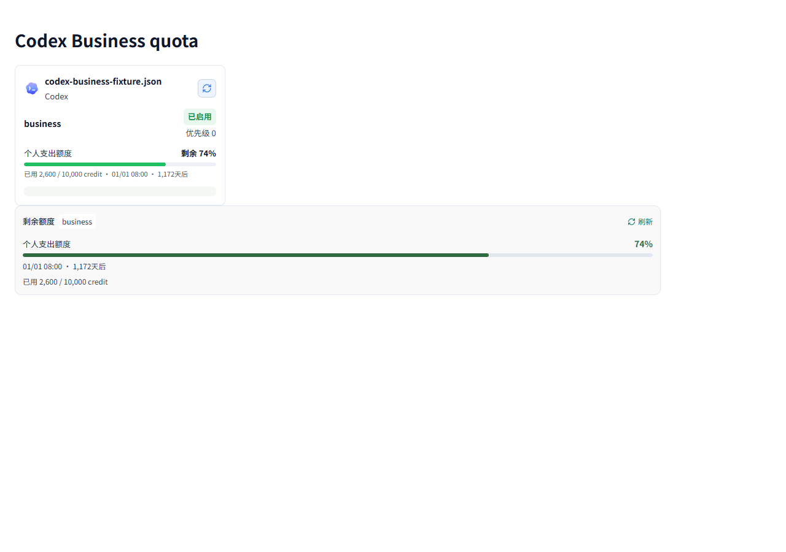
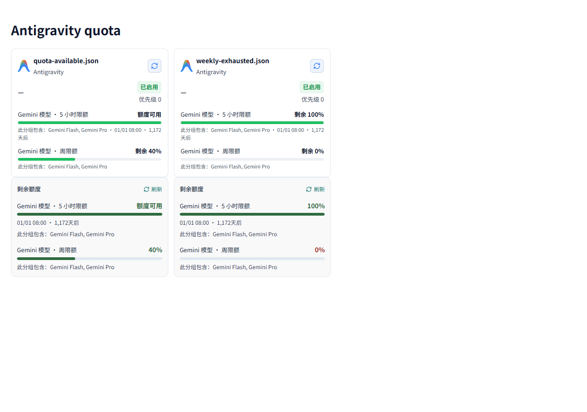
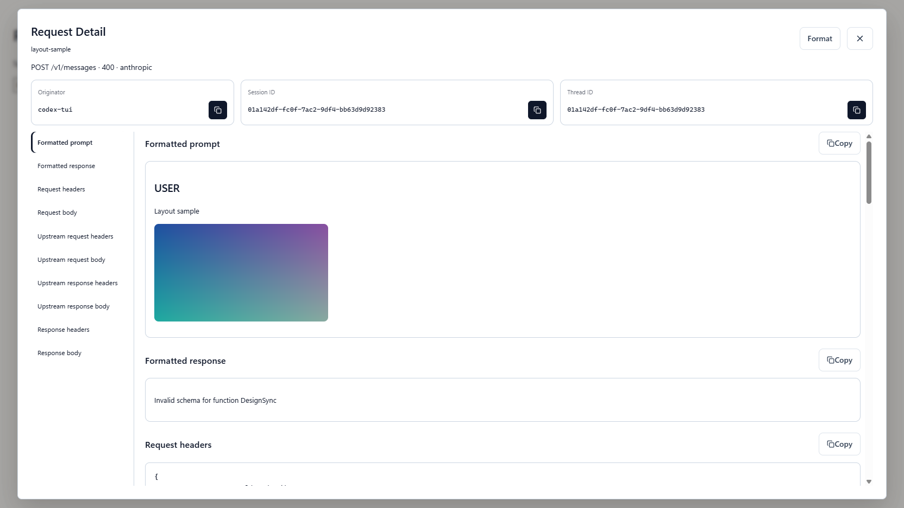

# 原版更新移植记录（2026-10-16）

本轮对两个原版仓库执行了 `git pull --ff-only`，拉取前后工作区均干净：

- CLIProxyAPI：`0d18d3b3` → `355fd10e`，28 个提交，127 个文件发生变化。
- EasyCLIProxyAPI：`654731c` → `01e3bed`，47 个提交，168 个文件发生变化。

核心更新主要涉及协议兼容、请求冷却、凭据配置、模型目录和插件加载；桌面更新主要涉及额度展示、主题、下拉控件、Codex 管理、插件视图和升级恢复。移植按当前 Java 代理的协议链路与桌面组件逐项适配，没有直接覆盖原版目录。

## 已移植的行为

### Gemini 工具 Schema

参考上游 `e9ba5c50`。移除 Schema 节点中 Gemini 不支持的 `discriminator` 元数据，同时保留名为 `discriminator` 的业务属性、默认值和示例。递归范围限定为 Schema 结构，避免误删用户数据。

### Gemini 缓存与思考 token

参考上游 `912a038b`，覆盖非流式与 SSE，以及 Gemini 转 Anthropic、Chat Completions、Responses 的用量字段。

- Anthropic 的非缓存输入数使用 `max(0, promptTokenCount - cachedContentTokenCount)`。
- 输出数包含生成内容与思考 token；缺少生成内容计数时，从总数扣除原始输入和思考数推算，不把缓存输入算作输出。
- Chat Completions 和 Responses 保留缓存与 reasoning 明细。
- 原生 Gemini 请求记录使用相同归一化规则，使请求统计与协议转换结果一致。

例如：输入 100、缓存 80、思考 7、总数 120，且未提供生成内容计数时，Anthropic 输入为 20、输出为 20；Chat Completions 输入为 100、输出为 20、缓存为 80、reasoning 为 7。

### 并发请求冷却

参考上游 `35af74f9`。当一个请求收到限流或认证失败后，较早开始的另一个请求即使成功，也不会清除仍有效的冷却。冷却到期及手动重置仍然恢复可用状态。测试通过可控时钟验证，不依赖等待。

### Codex Business 个人支出额度

参考桌面上游 `6a92218`。解析 `spend_control.individual_limit`，展示剩余比例、已用额度和重置时间，保留常规限额窗口。显式的零额度不会被备用字段覆盖，未知额度不会被显示成无限额度。

下图使用匿名测试数据：总额 10,000 credit，已用 2,600，剩余 74%。不是用户真实账户额度。

### Antigravity 周期与可用状态

参考桌面上游 `6bcef8a` 和 `06bd770`。识别新版周期标签，支持本地化描述，并更新额度查询的客户端标识。当同组周额度耗尽时，五小时窗口即使报告 100%，也不再显示“额度可用”；百分比仍保留上游原值。模型列表仅展示响应中的实际内容。

下图为正常额度与周额度耗尽的匿名对照样本。

## 请求详情导航与图片预览

本轮同时完成先前请求的详情功能：宽窗口左侧提供章节导航，窄窗口改为横向导航；点击 Format 后动态加入格式化提示词和响应，并跳到提示词。支持常见图片内容块与 Markdown 图片，包含受支持的 Base64 位图和 HTTP(S) 地址，加载失败显示占位提示。远程图片能否显示仍取决于地址是否可访问。

## 验证方式

- Java 单元测试覆盖 Schema 清理、流式和非流式用量、并发冷却，以及图片内容格式化。
- 前端测试覆盖 Business 额度、Antigravity 周期与耗尽状态、请求参数和国际化；运行 TypeScript 检查及生产构建。
- 使用 `deepseek-browser-use` 启动可见 Chrome，在隔离的本地 fixture 页面检查导航、Format、图片加载及额度展示；截图保存在本目录的 `assets` 中。
- Java HTTP 集成测试使用独立临时数据目录和系统分配的空闲端口。未修改或停止正在使用的 8318 服务。
- 构建遵循项目 `build.txt`，使用 `mvn clean package -DskipTests -Dgpg.skip -Pproduction`；单元测试独立执行。

浏览器 fixture 使用合成或匿名数据，验证页面渲染与交互，不代表已经向真实上游账户发起调用。

最终验证：58 项 Java 单元测试通过；32 个协议 HTTP 用例及别名、前缀、会话亲和、凭据故障切换、重试上限场景通过；后端 HTTP 冒烟测试通过。验证中同步更新了旧别名测试：调用工具范围内的别名时显式传入 `x-llm-proxy-tool: claude-desktop`，并保留未指定工具时不可访问该别名的负例。

## 本轮未直接移植的更新

- Codex SIWC 的 `configuration_update` 降级：当前 Java 实现没有 SIWC 专用凭据与执行路径，普通 Codex 请求应保留自身能力。
- Vertex 路径拼接修复：当前 Java 实现已经支持完整的 publishers 前缀，没有相同的重复拼接问题。
- xAI 搜索参数清理：需先完善 xAI 的 Responses 工具与执行路径，再统一适配。
- 主题系统、插件原生视图、平台升级恢复等大范围改造：与当前桌面架构存在差异，保留为后续独立评估项。

本轮改动均位于应用仓库，没有新增框架 API，因此无需修改框架源码或向框架文档加入应用专属内容。
